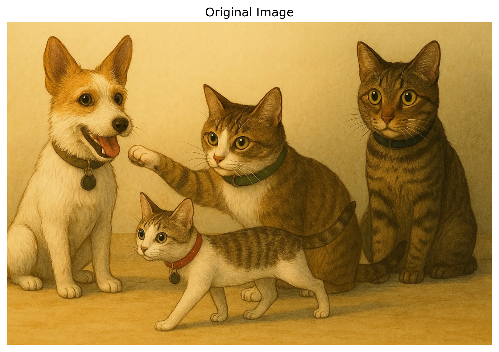
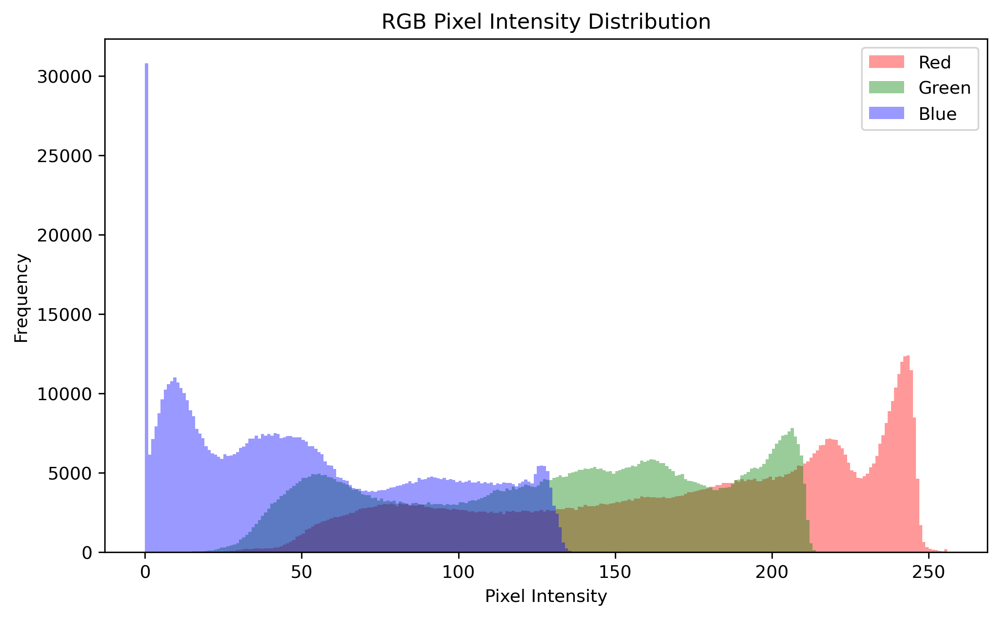

# Image Compression with the SVD

**DS5020 Final Project, Iteration 2**

**Team Members:** Chengyuan Liu, Wan Chi Kao

## Project Overview

In this project, we study how Singular Value Decomposition (SVD) can be used for image compression. The main idea is to use fewer singular values to represent an image, so we can reduce the storage cost without losing too much information.

For Iteration 2, we focus on the mathematical part of SVD. We answer five questions about eigenvalues, singular vectors, rank-one decomposition, Frobenius norm, and rank-k approximation. We also analyze a real image and use a simulation to check our mathematical results.

## Project Structure

```text
.
├── data/
│   └── photo.jpeg
├── figures/
│   ├── original_image.png
│   └── rgb_histogram.png
├── src/
│   ├── image_analysis.py
│   └── simulation.py
├── docs/
│   ├── iteration2.pdf
│   └── project_plan.xlsx
└── README.md
```

The `data` folder contains the original image used in our project. The `figures` folder contains the figures generated from the image analysis.

The `src` folder contains two Python files. `image_analysis.py` is used to analyze the real image, and `simulation.py` is used to check our mathematical results.

The `docs` folder contains our Iteration 2 report and the updated project plan.

## Requirements

We use Python 3 and the following libraries:

- NumPy
- Matplotlib
- Pillow

To install the libraries:

```bash
python -m pip install numpy matplotlib pillow
```

## How to Run

Run the following commands from the main repository folder.

### Real Image Analysis

```bash
python src/image_analysis.py data/photo.jpeg
```

This code reads the original image and analyzes its size and RGB pixel values. It also generates the figures used in our report.

### Simulation

```bash
python src/simulation.py
```

This code generates a random matrix with an underlying rank of 5 and adds a small amount of noise. We use a fixed random seed of 0, so the results can be reproduced.

We calculate the singular values using eigen-decomposition of \(A^T A\). At the end, we compare our results with NumPy SVD.

## Mathematical Questions

In our report, we answer five questions:

1. **Q1:** Why \(A^T A\) is symmetric and positive semidefinite.
2. **Q2:** Why the calculated left singular vectors are orthonormal.
3. **Q3:** How to express a matrix as a sum of rank-one matrices.
4. **Q4:** The relationship between the Frobenius norm and singular values.
5. **Q5:** How rank-k approximation affects reconstruction error and storage cost.

The mathematical proofs and detailed explanations are included in our report.

## Real Data Analysis

We use a color image with a size of 724 × 1086 pixels. Since it is an RGB image, we analyze the red, green, and blue channels separately.

We also generate an RGB histogram to see how the pixel values are distributed in each channel.





## Simulation Results

For the simulation, we generate a 120 × 80 matrix with an underlying rank of 5. We then add random noise with a scale of 0.01.

After adding noise, the matrix has a rank of 80. However, we can still see a large difference between the fifth and sixth singular values. The fifth singular value is 71.8822, while the sixth is only 0.1899. This matches the underlying rank we used to generate the matrix.

We also check our mathematical results from Q1 to Q5.

| Check | Result |
|---|---|
| Q1: Minimum eigenvalue | 0.0004896 |
| Q2: Orthonormality error | 1.11e-15 |
| Q3: Reconstruction error | 2.12e-13 |
| Q4: Squared Frobenius norm | 42311.0769 |
| NumPy SVD comparison | 1.01e-11 |

For Q5, we compare the actual reconstruction error with the theoretical result.

| k | Squared Reconstruction Error | Theoretical Error | Storage Cost |
|---|---:|---:|---:|
| 1 | 30397.1176 | 30397.1176 | 201 |
| 3 | 11318.1041 | 11318.1041 | 603 |
| 5 | 0.8730 | 0.8730 | 1005 |
| 10 | 0.7077 | 0.7077 | 2010 |

From the results, we can see that the reconstruction error becomes smaller when k increases. When k reaches 5, the error is already very small. If we increase k to 10, the error only decreases a little, but the storage cost becomes twice as much.

Finally, we compare our calculated singular values with NumPy SVD. The maximum difference is `1.01e-11`, so the two methods give almost the same results.

## Reproducibility

We use `np.random.default_rng(0)` to fix the random seed in our simulation. This allows us to generate the same matrix and get the same results when running the code again.

We also include the original image, Python code, and generated figures in this repository, so the analysis and simulation can be repeated.

## Project Report

Our full report is written in LaTeX using Overleaf. It includes the mathematical notation, definitions, assumptions, proofs, algorithm, real data analysis, and simulation results.

[Iteration 2 Report (PDF)](docs/iteration2.pdf)

The updated Excel project plan is also included in the `docs` folder.
