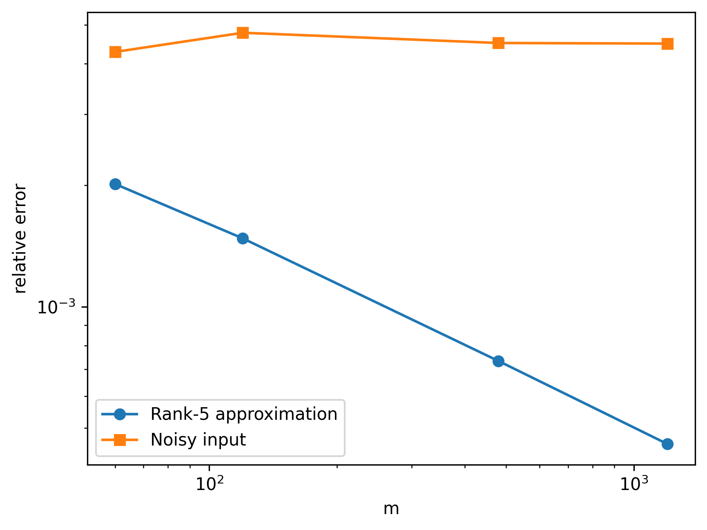
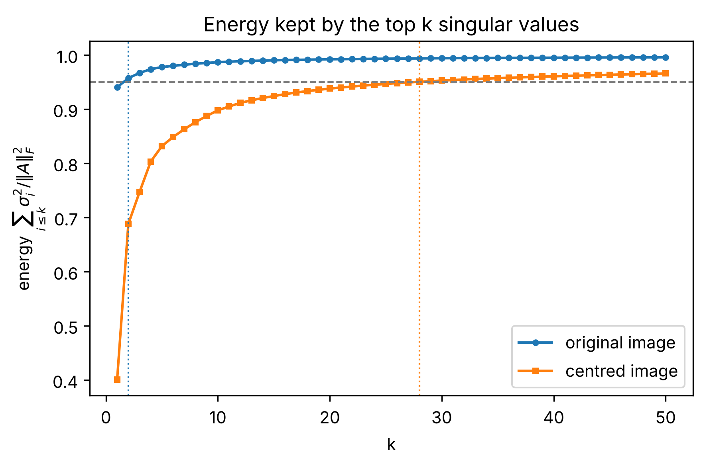
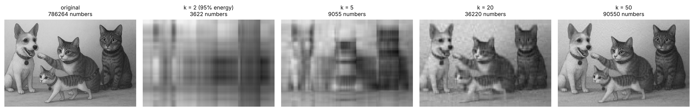
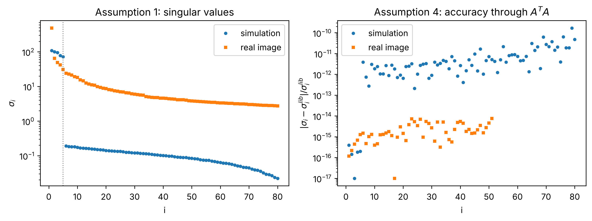

# Image Compression with the SVD

**DS5020 Final Project, Iteration 3**

**Team Members:** Chengyuan Liu, Wan Chi Kao
**Project Leader (Iteration 3):** Wan Chi Kao

## Project Overview

In this project, we study how the Singular Value Decomposition (SVD) can be used for image compression. The main idea is to keep only the largest singular values, so we can reduce the storage cost without losing too much information.

In Iteration 2, we derived the mathematics of the SVD and checked it with a simulation. In Iteration 3, we implement the SVD **from scratch with NumPy only** (power iteration with deflation on $A^\top A$) and verify it in three ways:

1. A small worked example ($2 \times 2$) computed step by step with exact fractions.
2. A simulation where the true answer is known, compared with the truth and with `numpy.linalg.svd`.
3. The real image, compared with `numpy.linalg.svd`.

`numpy.linalg` is used only to check our answers, never inside `src/methods.py`.

The Iteration 2 version of this repository is saved as the release **`iteration-2`**.

## Project Structure

```text
.
├── data/
│   └── photo.jpeg
├── figures/
│   ├── original_image.png
│   ├── rgb_histogram.png
│   ├── grayscale_image.png
│   ├── sim_error_vs_size.png
│   ├── real_energy.png
│   ├── real_reconstructions.png
│   └── assumption_checks.png
├── src/
│   ├── methods.py            # from-scratch SVD, one function per algorithm step
│   ├── simulate.py           # simulate_low_rank(): the Iteration 2 simulation as a function
│   ├── small_example.py      # the 2 x 2 example, step by step
│   ├── check_simulation.py   # simulation test
│   ├── run_real.py           # real image and library comparison
│   ├── check_assumptions.py  # assumption checks on simulated and real data
│   ├── verify.py             # comparison and sign-alignment helpers
│   ├── image_analysis.py     # data exploration and load_image()
│   ├── test_methods.py       # quick tests of each function in methods.py
│   └── simulation.py         # Iteration 2 simulation check (kept for reference)
├── docs/
│   ├── iteration2.pdf
│   ├── iteration3.pdf
│   ├── Iteration2_Project_Plan.xlsx
│   └── Iteration3_Project_Plan.xlsx
└── README.md
```

## Requirements

We use Python 3 and the following libraries:

- NumPy
- Matplotlib
- Pillow (only to read the image file)

```bash
python -m pip install numpy matplotlib pillow
```

## How to Run

Run every command from the main repository folder, so that figures are saved in `figures/`.

### 1. Small worked example

```bash
python src/small_example.py
```

Computes the SVD of A = [[3, 0], [4, 5]] step by step with exact fractions, checks it by substitution, then runs `my_svd_power` on the same matrix and compares with the exact values and `numpy.linalg.svd`.

### 2. Simulation test

```bash
python src/check_simulation.py
```

Runs the from-scratch SVD on the Iteration 2 simulation (120 × 80, rank 5 plus noise 0.01, seed 0) in three parts:

- **Part 1:** compares $\sigma_i$, $U$ and $V$ (signs aligned) with `numpy.linalg.svd`, and checks $\Vert A - A_5\Vert _F^2 = \sum_{i>5} \sigma_i^2$.
- **Part 2:** compares the rank-5 approximation with the noise-free truth $L$ for four sizes and saves `figures/sim_error_vs_size.png`.
- **Part 3:** stress test with $k = 8$, showing slow convergence when $\sigma_{i+1}/\sigma_i$ is close to 1.

### 3. Real image

```bash
python src/run_real.py
```

Loads `data/photo.jpeg` as a grayscale matrix in [0, 1], runs `my_svd_power` (k = 50), compares with `numpy.linalg.svd`, prints the energy, error and storage cost for k = 2 (95% energy), 5, 16 (99% energy), 20 and 50, and saves `figures/real_energy.png` and `figures/real_reconstructions.png`. The script takes no command-line arguments.

### 4. Assumption checks

```bash
python src/check_assumptions.py
```

Checks the four Iteration 2 assumptions on the simulation first, then on the real image, and saves `figures/assumption_checks.png`.

`src/verify.py` holds the shared `report(name, mine, ref)` helper and the sign-alignment helper used by the small-example and real-data scripts.

### Other scripts

```bash
python src/test_methods.py                   # test each function in methods.py on the 2 x 2 example
python src/simulate.py                       # check that the simulation matches Iteration 2 exactly
python src/image_analysis.py data/photo.jpeg # image statistics and figures
```

## Results

### Simulation test

Comparison with `numpy.linalg.svd` (120 × 80):

| Quantity | Max difference |
|---|---:|
| $\sigma_1, \dots, \sigma_5$ | 7.11e-14 |
| $U$ (signs aligned) | 2.61e-12 |
| $V$ (signs aligned) | 3.03e-12 |
| Squared Frobenius reconstruction error versus sum of squared discarded singular values | 1.78e-15 |

Comparison with the truth $L$:

| Size | $\Vert A_5 - L\Vert _F / \Vert L\Vert _F$ | $\Vert A - L\Vert _F / \Vert L\Vert _F$ |
|---|---:|---:|
| 60 × 40 | 2.01e-03 | 4.28e-03 |
| 120 × 80 | 1.48e-03 | 4.78e-03 |
| 480 × 320 | 7.33e-04 | 4.50e-03 |
| 1200 × 800 | 4.56e-04 | 4.49e-03 |

The log–log slope is −0.50, so the error shrinks like $1/\sqrt{m}$.



Stress test ($k = 8$): the noise singular values $\sigma_6, \sigma_7, \sigma_8$ are almost equal ($\sigma_8/\sigma_7 \approx 0.99$), so $v_8$ needs about 1,900 iterations, while $v_1, \dots, v_5$ need at most about 250.

### Small worked example

For A = [[3, 0], [4, 5]], the eigenvalues of AᵀA are 45 and 5, giving singular values 3√5 and √5. The exact rank-1 approximation is [[3/2, 3/2], [9/2, 9/2]], and its squared Frobenius error is exactly 5. The from-scratch implementation agrees with the exact singular vectors to about 6e-13 after sign alignment.

### Real image

The image is 724 × 1086. In Iteration 2 we analyzed the RGB channels; in Iteration 3 we convert it to grayscale ($0.299R + 0.587G + 0.114B$) and scale it to $[0, 1]$, as the Iteration 3 handout asks.

The top 50 singular values agree with NumPy to about 2e-13 in maximum absolute difference. After sign alignment, U and V agree to about 4e-11. These numerical differences may vary slightly across environments.

The smallest k retaining 95% of the original image energy is 2. The first singular value alone retains 94.01%, while the constant mean-brightness component accounts for 86.75% of the image's total squared Frobenius norm. Retaining 95% of the energy therefore still gives a visibly blurred reconstruction. Retaining 99% requires k = 16. For the centred image, retaining 95% requires k = 28.

| k | Energy retained | Relative Frobenius error | Stored values | Fraction of original storage |
|---:|---:|---:|---:|---:|
| 2 (95% energy) | 95.69% | 20.75% | 3,622 | 0.46% |
| 5 | 97.74% | 15.03% | 9,055 | 1.15% |
| 20 | 99.17% | 9.09% | 36,220 | 4.61% |
| 50 | 99.54% | 6.75% | 90,550 | 11.52% |

The original matrix stores 786,264 values. The rank-k representation stores k(m + n + 1) values. These counts compare numbers of stored values.





### Assumption checks

The simulated data has a clear singular-value gap at rank 5. The real image has a gradual tail after its leading components. Small relative Frobenius error can coexist with large local pixel errors, so the reconstruction images are also inspected.

The singular values are decreasing and the retained left singular vectors are approximately orthonormal. The real image is 724 × 1086, so AᵀA is singular. Its zero eigenvalues do not prevent computing the leading components; the computed top 50 singular values agree closely with NumPy. The full simulation's small noise components show greater numerical error than its leading five components.



## Reproducibility

We use `np.random.default_rng(0)` to fix the random seed. `simulate_low_rank()` draws the random numbers in the same order as the Iteration 2 script, so it produces exactly the same matrix.

## Project Report

Our report is written in LaTeX on Overleaf.

- [Iteration 2 Report (PDF)](docs/iteration2.pdf)
- [Iteration 3 Report (PDF)](docs/Iteration_2_and_3.pdf)

The updated Excel project plan is in the `docs` folder.

The updated plan is [Iteration3_Project_Plan.xlsx](docs/Iteration3_Project_Plan.xlsx).
